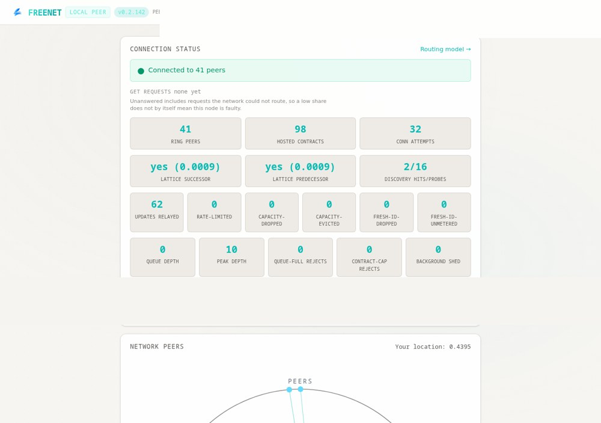

<h1>
  
  Freenet pour YunoHost
</h1>

Freenet est un réseau peer-to-peer anonyme et résistant à la censure : sites (Freesites), messagerie, forums et partage de fichiers, sans serveur central. Ce paquet exécute le nœud Freenet officiel en natif (Java, sans Docker).

**Version livrée :** voir manifest.toml

## Caractéristiques

- Nœud Freenet natif (Java) avec service systemd
- Tableau de bord du nœud accessible via le portail YunoHost
- Persistance de la base de données du nœud (data_dir)
- Mises à jour automatiques optionnelles du nœud

## Liens

- Projet amont : <https://github.com/freenet/freenet-core>
- Paquet YunoHost : <https://github.com/quartztester/freenet_ynh>

## Screenshots

